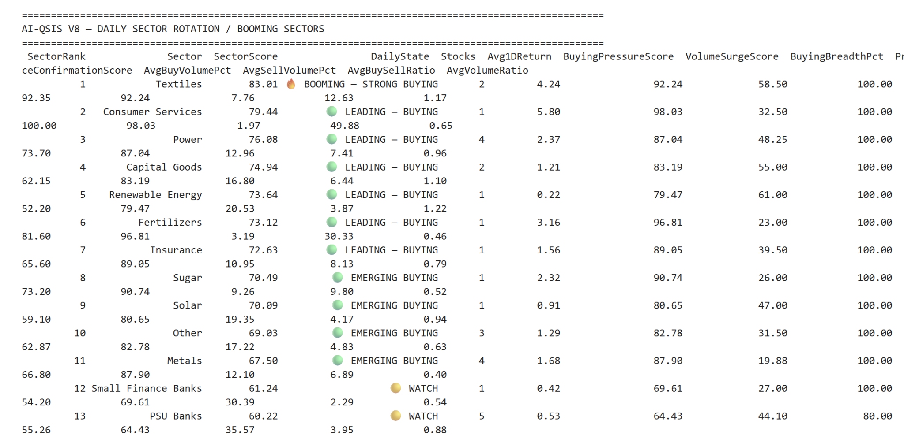
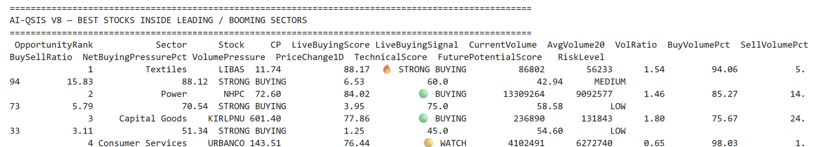
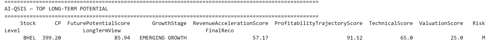
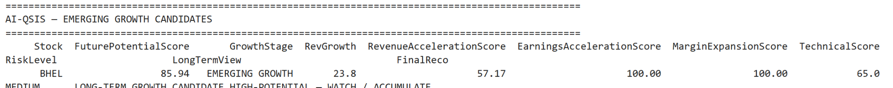
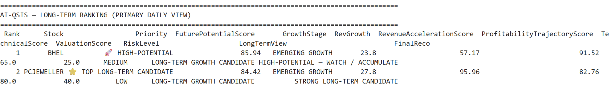
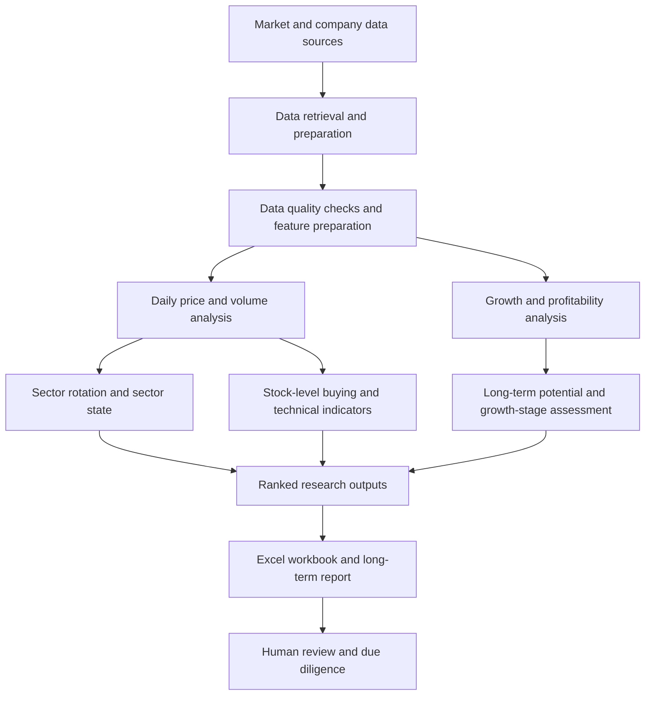
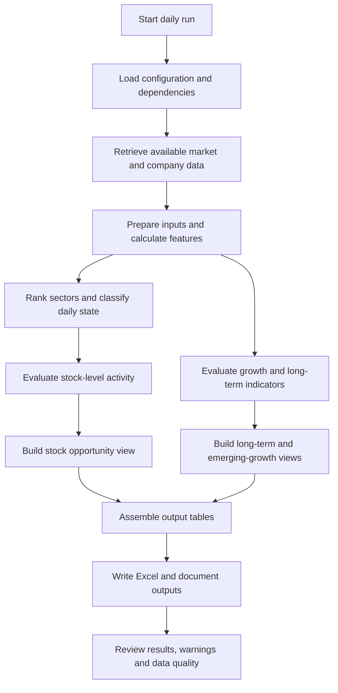

# AI-QSIS V8 — AI Quantitative Stock Intelligence System

  <strong>Daily sector intelligence · Stock opportunity screening · Long-term growth research · Risk-aware decision support</strong>

AI-QSIS is a Python-based quantitative stock research and screening project designed to organise daily market observations into structured, interpretable research outputs. It combines sector-level strength indicators, stock-level price and volume signals, growth-related measures, technical and valuation scores, risk labels, and ranked research candidates.

> **Project purpose:** help a researcher move from a broad market universe to a prioritised set of sectors and stocks for further investigation. AI-QSIS is a research-support system—not an automated trading service, a guarantee of returns, or personalised investment advice.

---

## At a glance

| Capability | What the output helps answer |
|---|---|
| **Sector rotation analysis** | Which sectors rank strongly under the current daily scoring rules? |
| **Stock opportunities within leading sectors** | Which stocks combine sector context with buying-related, volume and technical indicators? |
| **Long-term potential ranking** | Which companies rank highly on the system's growth, profitability, technical and valuation measures? |
| **Emerging-growth screening** | Which candidates show growth-related characteristics worth investigating? |
| **Risk-aware reporting** | What risk category and explanatory labels accompany each candidate? |
| **Excel and document reporting** | How can results be reviewed, filtered, compared and shared? |

## Table of contents

- [Business objective](#business-objective)
- [Why the project matters](#why-the-project-matters)
- [Current analytical views](#current-analytical-views)
- [Explore every Excel workbook page](#explore-every-excel-workbook-page)
- [Score methodology and validation](#score-methodology-and-validation)
- [Output examples](#output-examples)
- [How to read the scores](#how-to-read-the-scores)
- [Conceptual architecture](#conceptual-architecture)
- [Daily processing workflow](#daily-processing-workflow)
- [Output files](#output-files)
- [Technology stack](#technology-stack)
- [Data quality, validation and limitations](#data-quality-validation-and-limitations)
- [How to run](#how-to-run)
- [Public repository scope and intellectual property](#public-repository-scope-and-intellectual-property)
- [Roadmap: potential future enhancements](#roadmap-potential-future-enhancements)
- [Disclaimer](#disclaimer)

---

## Business objective

Financial market research can involve reviewing many securities, comparing sector behaviour, checking trading activity, studying company growth, and interpreting technical and valuation indicators. These tasks can become fragmented when each is examined in isolation.

AI-QSIS is intended to bring those observations into a repeatable daily research workflow. Rather than presenting a single unexplained stock list, it produces several complementary views:

1. **Market context:** rank sectors and label their current state.
2. **Opportunity discovery:** examine individual stocks within leading or booming sectors.
3. **Long-term research:** compare companies using growth, profitability, technical and valuation measures.
4. **Candidate discovery:** surface emerging-growth names for additional due diligence.
5. **Decision support:** place scores, risk labels and recommendation text into structured reports.

The goal is to make the research process more organised, traceable and reviewable—not to remove human judgement.

## Why the project matters

### From raw observations to research priorities

The reporting structure helps a user progress from a broad market view to a smaller set of candidates. Sector strength provides context; stock-level signals add market activity information; growth and profitability features provide a separate longer-term lens; and risk labels encourage further review before any decision.

### Short-term signals and long-term potential are not the same thing

A stock may display strong daily buying-related indicators without having attractive long-term fundamentals. Conversely, a company may rank well on growth-related measures while its short-term entry conditions are weak. AI-QSIS presents distinct views so these questions are not treated as interchangeable.

### Scores are aids to comparison—not certainty

A score is a model-generated measure under the project's rules. Its meaning depends on the underlying data, feature definitions, weights, thresholds and validation. A higher score should not be interpreted as a guaranteed higher return or as proof of predictive accuracy.

---

## Current analytical views

The sections below describe the output views demonstrated by the supplied V8 run and screenshots. The exact score formulas and thresholds should be documented from the implementation rather than inferred from column names alone.

### 1. Daily Sector Rotation / Booming Sectors

**Question answered:** Which sectors rank strongly under the current daily sector-scoring framework?

Key fields shown in the output include:

- `SectorRank` — position in the sector ranking.
- `Sector` — sector name assigned by the system.
- `SectorScore` — composite sector score; exact components and weights should be verified in source code.
- `DailyState` — a descriptive state such as `BOOMING – STRONG BUYING`, `LEADING – BUYING`, `EMERGING BUYING` or `WATCH`.
- `Stocks` — count of stocks represented in that sector's output.
- `Avg1DReturn` — average one-day return for the represented stocks.
- `BuyingPressureScore` and `VolumeSurgeScore` — scores associated with buying-related activity and volume changes.
- `BuyingBreadthPct` — percentage measure based on the system's buying-related criteria.
- `PriceConfirmationScore` — price-related confirmation measure.
- `AvgBuyVolumePct`, `AvgSellVolumePct`, `AvgBuySellRatio` and `AvgVolumeRatio` — additional directional-volume estimates and relative-volume measures.

**Example from the supplied output:** Textiles is ranked first with `SectorScore = 83.01` and the state `BOOMING – STRONG BUYING`. This means it ranks strongly according to the current system rules; it does not mean every stock in that sector is attractive or that the sector will continue rising.

### 2. Best Stocks Inside Leading / Booming Sectors

**Question answered:** Which individual stocks stand out within the sectors selected by the sector analysis?

Key fields shown in the output include:

- `OpportunityRank`, `Sector`, `Stock` and `CP` (current price as represented in the output).
- `LiveBuyingScore` and `LiveBuyingSignal` — a buying-related score and its descriptive category.
- `CurrentVolume`, `AvgVolume20` and `VolRatio` — current volume, its 20-period average and the reported ratio.
- `BuyVolumePct`, `SellVolumePct`, `BuySellRatio` and `NetBuyingPressurePct` — directional-volume indicators.
- `VolumePressure` and `PriceChange1D` — volume-related and one-day price-movement measures.
- `TechnicalScore`, `FuturePotentialScore` and `RiskLevel` — technical, longer-term potential and assigned risk outputs.

**Example from the supplied output:** LIBAS, NHPC and KIRLPNu appear among the first displayed opportunities. These are screening results for follow-up research, not automatic buy instructions.

### 3. Top Long-Term Potential

**Question answered:** Which companies rank highly in the system's long-term potential view?

The displayed fields include `FuturePotentialScore`, `GrowthStage`, `RevenueAccelerationScore`, `ProfitabilityTrajectoryScore`, `TechnicalScore`, `ValuationScore`, `RiskLevel`, `LongTermView` and `FinalReco`.

These fields provide different lenses: growth-related measures, profitability trajectory, technical context, valuation and a risk classification. They should be read together, not treated as independent guarantees.

**Example from the supplied output:** BHEL is shown with a `FuturePotentialScore` of `85.94` and a `GrowthStage` of `EMERGING GROWTH`. This is a system-generated ranking result, not a forecast that its share price will rise.

### 4. Emerging Growth Candidates

**Question answered:** Which companies meet the system's emerging-growth screening criteria?

The output includes `RevGrowth`, `RevenueAccelerationScore`, `EarningsAccelerationScore`, `MarginExpansionScore`, `TechnicalScore`, `RiskLevel`, `LongTermView` and `FinalReco`, alongside the overall potential score and growth-stage label.

**Example from the supplied output:** BHEL is shown with `RevGrowth = 23.8`, `RevenueAccelerationScore = 57.17`, `EarningsAccelerationScore = 100.00` and `MarginExpansionScore = 100.00`. The period, units and calculation used for `RevGrowth`, as well as the score scaling, should be confirmed from the implementation before interpreting these figures as financial metrics.

A company appearing in multiple views is not necessarily a duplicate: each report serves a different screening purpose. The underlying records and calculations should nevertheless be checked for consistency.

### 5. Long-Term Ranking — Primary Daily View

**Question answered:** Which candidates should the researcher review first across the long-term scoring dimensions?

The primary view consolidates `Rank`, `Stock`, `Priority`, `FuturePotentialScore`, `GrowthStage`, `RevGrowth`, `RevenueAccelerationScore`, `ProfitabilityTrajectoryScore`, `TechnicalScore`, `ValuationScore`, `RiskLevel`, `LongTermView` and `FinalReco`.

**Example from the supplied output:** BHEL appears at rank 1 with a potential score of `85.94` and PCJEWELLER at rank 2 with `84.42`. This ordering reflects the system's scoring rules and input data for that run; it does not establish that the first-ranked stock will outperform the second.

---

## Explore every Excel workbook page

The workbook contains more views than can be explained fully in a single README section. Use the dedicated guides below for page-by-page descriptions, column families, interpretation notes, and implementation details that still require source verification.

| Workbook view / topic | Detailed guide | What it explains |
|---|---|---|
| Full workbook index | [Excel Workbook Guide](docs/EXCEL_WORKBOOK_GUIDE.md) | Every supplied sheet name, its purpose, field interpretation, caveats, and cross-page glossary. |
| All Stocks and candidate lists | [Stock Screening Pages](docs/STOCK_SCREENING_PAGES.md) | All Stocks, Emerging Growth, Breakout candidates, Reversal candidates, EOD candidates, Premarket Strength, and near-52-week-low views. |
| Sector rotation and V8 opportunity views | [Sector Rotation and Opportunities](docs/SECTOR_ROTATION_AND_OPPORTUNITIES.md) | VB Sector Rotation, VB Booming, VB Best Sector Stocks, sector signals and additional V8 fields. |
| Long-term scoring and scenarios | [Long-Term Growth and Ranking](docs/LONG_TERM_GROWTH_AND_RANKING.md) | LongTerm Ranking, growth features, FuturePotentialScore, risk labels and scenario fields. |
| Validation and score interpretation | [Scoring and Validation](docs/SCORING_AND_VALIDATION.md) | What to verify for formulas, data quality, volume estimates, historical testing and release readiness. |

### Workbook page families at a glance

- **LongTerm Ranking:** concise ranked view with priority, long-term potential, growth, technical, valuation, risk and scenario fields.
- **All Stocks:** the broad research table combining price range, momentum, volume, technical, fundamental, factor-score and narrative fields.
- **Premarket Strength:** focused market-bias and factor-score view; the page name does not by itself prove all data is available before market open.
- **Emerging Growth, Breakout_candidates, reversal candidates, and eod candidates:** candidate lists using the broad stock schema but intended for different research questions. Their exact selection rules must be verified from the implementation.
- **VB Sector Rotation and VB Booming:** sector-level return, breadth, buying-related, volume and confirmation fields.
- **VB Best Sector Stocks:** broad stock context plus sector score and V8 opportunity fields.
- **Within 10% low, 5% low and 2% low:** near-52-week-low views; confirm the exact filter formula before interpreting membership.

The same column headers across multiple tabs do not prove that the tabs use the same filters, thresholds, data timestamps or sorting logic. Each page should have its own verified selection-rule description.

## Score methodology and validation

AI-QSIS exposes raw metrics, derived indicators, component scores, composite scores, ranks, categories and narrative fields. These are different kinds of outputs and should be explained separately. Column names alone do not establish formulas, weights, thresholds or predictive validity. See the [Scoring and Validation guide](docs/SCORING_AND_VALIDATION.md) for the verification checklist.

In particular, directional buy/sell volume fields derived from OHLCV candles should be described as estimates unless they use verified trade-level aggressor-side data. A successful Excel export demonstrates that reporting ran; it does not prove that the scores predict returns.

## How to read the scores

| Field / label | Practical interpretation | Important caution |
|---|---|---|
| `SectorScore` | Relative sector ranking under the current methodology | Confirm the feature weights and thresholds in source code |
| `LiveBuyingScore` / `LiveBuyingSignal` | Buying-related signal for a stock | Not a verified order-flow measure unless backed by trade-level data |
| `VolRatio` / `AvgVolumeRatio` | Relative trading activity compared with an average | Confirm the averaging window and zero/missing-volume handling |
| `FuturePotentialScore` | Composite score used to rank long-term research candidates | Not a probability of success or a guaranteed return forecast |
| `GrowthStage` | Rule-based growth category | A category is only as reliable as its input data and rules |
| `TechnicalScore` | Technical-analysis component | Does not independently establish investment quality |
| `ValuationScore` | Valuation-related component | Must be interpreted in the context of the valuation method and available financial data |
| `RiskLevel` | System-assigned risk classification | A `LOW` label does not mean risk-free; the classification is not a complete risk model unless explicitly validated as such |
| `LongTermView` / `FinalReco` | Summary interpretation and recommendation label | Read alongside source data, assumptions and limitations |

### Directional volume: a key limitation

If buying and selling percentages are inferred from OHLCV candle direction or close location, they are **estimates of directional volume**, not exchange-confirmed buyer-initiated and seller-initiated volume. Actual aggressor-side flow requires appropriate trade-level or exchange-provided data. The README should not describe these estimates as confirmed institutional buying or selling.

---

## Conceptual architecture

The diagram below represents the high-level analytical flow implied by the reporting outputs. It is a conceptual overview, not a verified function-by-function source-code map.

### Analytical layers

1. **Data layer:** retrieves available market and company data from the configured sources.
2. **Preparation layer:** prepares the inputs required by the daily calculations; data quality and missing-data behaviour must be reviewed.
3. **Feature layer:** calculates the measures used by sector, stock, technical, growth, profitability and valuation views.
4. **Scoring and classification layer:** produces scores, ranks, labels and recommendation text according to the implementation's rules.
5. **Reporting layer:** organises results into console summaries, an Excel workbook and a long-term report.
6. **Human review layer:** provides a structured starting point for further financial, risk and data-quality investigation.

---

## Daily processing workflow

This workflow describes the logical sequence of the reported capabilities. Exact ordering, error handling, retries, validation coverage and calculation details must be confirmed against the implementation.

---

## Output files

The supplied run uses an output folder named `AI_QSIS_Output`. The example filenames observed in the supplied project output are date-stamped:

- `AI_QSIS_Output/AI_QSIS_2026-10-27.xlsx` — Excel workbook containing the analytical tables.
- `AI_QSIS_Output/AI_QSIS_LongTerm_Report_2026-10-27.docx` — long-term report document.

The date is an example from the supplied run; future runs may use different dates. Confirm the actual output naming rules in the implementation.

### Example run summary

The supplied run summary reported the following counts for 27 October 2026:

| Metric | Reported count |
|---|---:|
| Stocks processed | 61 |
| Stocks skipped | 0 |
| Emerging-growth candidates | 23 |
| Breakout candidates | 0 |
| Reversal candidates | 5 |
| EOD candidates | 5 |
| Sectors ranked in V8 | 26 |
| Booming / leading sectors in V8 | 13 |
| Sector-stock opportunities in V8 | 24 |

These are example run results, not a guarantee of future output counts or proof of predictive performance.

---

## Technology stack

The supplied implementation context references Python and libraries including:

- **pandas** and **NumPy** for tabular and numerical processing.
- **yfinance** and **nsepython** for market-data retrieval, subject to their availability, coverage and terms.
- **openpyxl** for Excel workbook handling.
- **python-docx** for Word report generation.
- **python-dotenv** for environment-based configuration where used.

The exact dependency list and supported versions should be taken from the project's maintained `requirements.txt`. External data availability can change, and a successful download does not guarantee that all fields are complete or suitable for analysis.

---

## Data quality, validation and limitations

A professional quantitative research workflow should make its assumptions and validation coverage explicit. The output screenshots demonstrate formatted analytical results; they do **not** prove that all of the checks below are already implemented. Treat this list as a documentation and verification checklist until each item is confirmed in source code or tests.

### Data validation

- Verify that symbols resolve to the intended securities and that prices and volumes are valid.
- Identify missing, stale, duplicated or inconsistent records.
- Check whether sufficient historical observations exist for rolling averages and technical indicators.
- Handle zero, null or unusually large volume values safely.
- Record data-source failures, skipped securities and reasons for exclusion.
- Confirm the timestamp, market session and date used to generate each report.

### Calculation and scoring validation

- Document the formulas, input features, scales, weights and thresholds for every composite score.
- Check expected score ranges and behaviour when inputs are missing.
- Confirm that rankings are deterministic for the same input data and configuration, where intended.
- Validate that labels such as `BOOMING`, `LEADING`, `WATCH`, `HIGH-POTENTIAL` and `RiskLevel` follow documented rules.
- Check for duplicated symbols, inconsistent rows and disagreement between related report views.
- Confirm the definition, period and units for `RevGrowth` and other financial-growth fields.

### Predictive validation

A functioning script and plausible-looking ranking are not evidence that a strategy predicts future returns. Stronger evaluation would require, where appropriate:

- historical backtesting with point-in-time data;
- protection against look-ahead and survivorship bias;
- walk-forward or out-of-sample evaluation;
- transaction-cost, liquidity and slippage assumptions;
- benchmark-relative returns and risk-adjusted performance measures;
- stability checks across market regimes; and
- clear reporting of failed runs and limitations, not only successful examples.

These should be described as implemented only after the project contains evidence that they have been performed.

---

## How to run

This public repository is intentionally documentation-focused and does not publish the proprietary Python implementation. Therefore, the repository alone is **not a runnable release**.

For a private local copy containing the implementation:

1. Use the Python environment and dependencies maintained for that private project.
2. Keep credentials and local configuration in environment files or another secure configuration mechanism; never commit secrets.
3. Run the private implementation using its documented entry point.
4. Review console warnings and skipped-stock counts.
5. Inspect the generated Excel workbook and Word report, checking the data date and assumptions before relying on any result.

The public documentation can explain the system's purpose and observed outputs, but it cannot reproduce the calculations without the withheld implementation and the required data access.

---

## Public repository scope and intellectual property

This repository is designed to showcase the project's **business objective, analytical design, report structure, example outputs, limitations and potential roadmap** without disclosing proprietary implementation details.

The public package is intended to exclude:

- Python implementation files and notebooks;
- API keys, passwords, tokens and private configuration;
- generated workbooks, private reports and raw datasets unless explicitly approved for publication; and
- private formulas, scoring weights or other confidential logic that the owner has chosen not to publish.

Review `.gitignore` and the staged changes before every commit. A `.gitignore` rule does not remove a file that is already tracked by Git. Verify the repository's file list and commit history before making the repository public or sharing an update.

---

## Roadmap: potential future enhancements

The following are **proposed directions, not claims of currently implemented features**. Prioritisation should depend on data availability, validation results and project goals.

1. **Investable universe and liquidity controls** — formalise universe membership, liquidity thresholds and exclusion rules.
2. **Data ingestion and quality monitoring** — add explicit freshness checks, provenance and failure reporting.
3. **Feature engineering governance** — document features, units, lookback periods and missing-data handling.
4. **Market-regime analysis** — evaluate whether sector and stock signals behave differently across regimes.
5. **Sector-rotation research** — assess the stability and usefulness of sector-state classifications.
6. **Factor research lab** — test individual factors before combining them into composite scores.
7. **Statistical stock ranking** — compare ranking methods with transparent baselines.
8. **Machine-learning ranking or probabilities** — consider only with sufficient point-in-time data and out-of-sample validation.
9. **Event and news intelligence** — explore event features only after source licensing, timestamping and evaluation are addressed.
10. **Trade-setup analysis** — separate setup identification from long-term company assessment.
11. **Position sizing and risk controls** — define portfolio-level exposure and loss constraints before any live use.
12. **Portfolio optimisation** — evaluate diversification, concentration and turnover.
13. **Backtesting framework** — test rules against historical data with realistic assumptions.
14. **Walk-forward validation** — measure robustness on data not used to tune the system.
15. **Performance and risk reporting** — report drawdown, volatility, benchmark comparison and costs where relevant.
16. **Research interface** — consider a dashboard only after metrics, data lineage and validation are reliable.
17. **Monitoring and reliability** — improve logs, retries, data-source monitoring and reproducibility.
18. **Governance and release discipline** — add versioned configurations, reproducible runs, test evidence and change documentation.

---

## Disclaimer

AI-QSIS is an analytical research and screening project. Its scores, classifications and recommendation labels are generated from data and rules that may contain errors, omissions, assumptions or biases. Market data can be delayed, incomplete or revised. Historical patterns do not guarantee future results. Nothing in this repository constitutes investment advice, a solicitation to buy or sell securities, or a promise of performance. Independent research, appropriate risk management and compliance with applicable laws and data-provider terms remain the user's responsibility.

---

## Project status

**Public-facing documentation and example report outputs.** The proprietary implementation is intentionally not included in this repository. Current capabilities described above are based on the supplied project context and example outputs; formulas, implementation details and validation coverage should be verified before being represented as fully tested.
